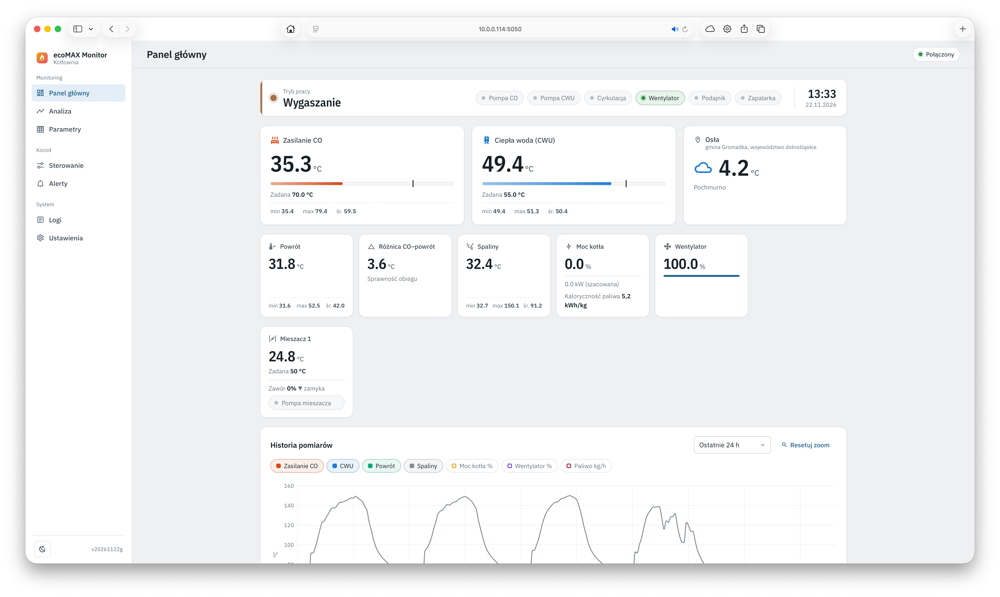
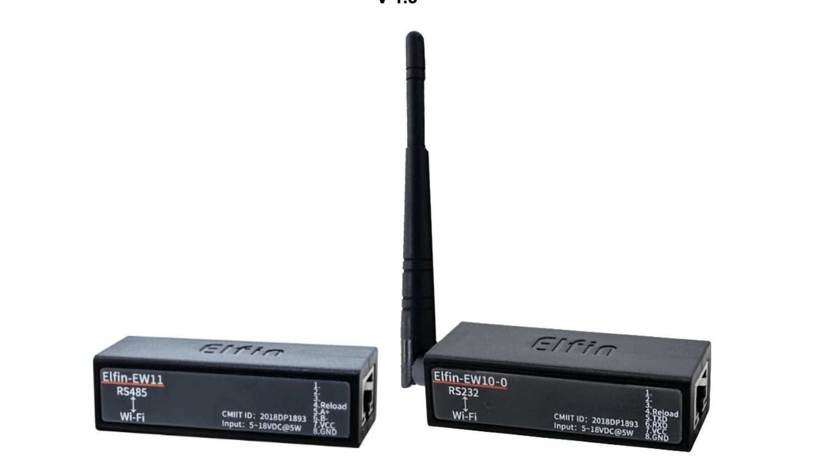

# ecoMAX Monitor

**Podgląd i sterowanie kotłem z przeglądarki — w domu, na telefonie lub komputerze.**

ecoMAX Monitor to darmowa aplikacja dla właścicieli kotłów na pellet lub ekogroszek ze sterownikiem **ecoMAX** firmy Plum. Pokazuje na bieżąco, co dzieje się w kotłowni: jakie są temperatury, czy kocioł pracuje, rozpala się czy wygasza, ile spala paliwa i ile to kosztuje. Pozwala też zmieniać najważniejsze nastawy bez chodzenia do kotłowni i powiadamia, gdy coś jest nie tak.

Aplikacja działa w Twojej sieci domowej. Nie wymaga konta w chmurze producenta, abonamentu ani Home Assistanta. Wszystkie dane zostają u Ciebie.



Więcej zrzutów ekranu znajdziesz w [galerii](screens.md).

## Co potrafi

### Podgląd na żywo

- Temperatury: kotła (CO), ciepłej wody (CWU), powrotu, spalin i — jeśli są podłączone — czujnika zewnętrznego, bufora i podajnika.
- Tryb pracy kotła (praca, nadzór, rozpalanie, wygaszanie, postój…) i godzina z serwera.
- Co aktualnie pracuje: pompy, wentylator, podajnik paliwa, zapalarka.
- Obieg mieszacza: temperatura, zadana i stopień otwarcia zaworu.
- Moc kotła, praca wentylatora, zużycie paliwa i szacowany koszt dnia.
- Pogoda dla miejsca, w którym stoi kocioł.

### Historia i analizy

- Wykresy temperatur i pracy kotła z ostatnich godzin, dni i tygodni.
- Ile czasu kocioł spędza w każdym trybie, ile razy się rozpala i jak często rozpalanie się nie udaje.
- Zużycie paliwa, koszt dzienny i miesięczny oraz koszt wyprodukowanej kilowatogodziny.
- Eksport danych do pliku CSV (np. do Excela).

### Alarmy i powiadomienia

- Pełna historia alarmów zapisanych w sterowniku (np. „nieudana próba rozpalania”, „zanik zasilania”) — także z okresów, gdy aplikacja była wyłączona.
- Własne alerty aplikacji: zbyt wysoka temperatura spalin, zbyt niska temperatura kotła, mało paliwa, utrata łączności.
- Powiadomienia pojawiają się od razu na otwartej stronie.

### Sterowanie

- Zmiana temperatur zadanych CO i CWU, histerez, trybu ciepłej wody, trybu lato, sterowania pogodowego i innych nastaw.
- Ustawienia obiegu mieszacza.
- Tygodniowe harmonogramy (np. obniżenie temperatury w nocy) ustawiane na wygodnej siatce godzin.
- Włączanie i wyłączanie kotła.
- Podgląd wszystkich parametrów pracy sterownika (rozpalanie, nadzór, wygaszanie, podawanie paliwa) z polskimi opisami.
- Historia wszystkich zmian — także tych zrobionych ręcznie na panelu kotła.
- Aplikacja sprawdza dozwolony zakres każdej wartości, zanim wyśle ją do sterownika.

### Dla zaawansowanych

- Podgląd wszystkich surowych danych, które wysyła sterownik.
- Integracja z Home Assistant i Prometheus/Grafana (opcjonalna).
- Tryb symulacji do testów bez kotła.

## Jak to działa

Sterownik ecoMAX ma gniazdo komunikacyjne (RS485, to samo, do którego podłącza się moduł internetowy ecoNET). Podłączasz do niego niewielki moduł **Elfin EW11A**, który przekazuje dane przez Wi‑Fi do Twojej sieci. Aplikacja działa na dowolnym komputerze w domu — najczęściej na Raspberry Pi albo małym serwerze — i udostępnia stronę, którą otwierasz w przeglądarce.

```text
[Sterownik ecoMAX] --kabel RS485--> [Elfin EW11A] --Wi-Fi--> [ecoMAX Monitor] --> przeglądarka
```

> Aplikacja rozmawia ze sterownikiem tym samym protokołem co oficjalny moduł ecoNET. Zmiany nastaw robisz na własną odpowiedzialność — tak samo jak na panelu kotła.

---

## Spis treści

- [Wymagania](#wymagania)
- [Instalacja](#instalacja)
- [Konfiguracja EW11A](#konfiguracja-ew11a)
- [Pierwsze uruchomienie i konfiguracja aplikacji](#pierwsze-uruchomienie-i-konfiguracja-aplikacji)
- [Uruchomienie](#uruchomienie)
- [Autostart (systemd)](#autostart-systemd)
- [Aktualizacja](#aktualizacja)
- [Strony aplikacji](#strony-aplikacji)
- [Dostęp i bezpieczeństwo](#dostęp-i-bezpieczeństwo)
- [REST API](#rest-api)
- [Integracje](#integracje)
- [Struktura plików](#struktura-plików)
- [Protokół komunikacji (ecoNET)](#protokół-komunikacji-econet)
- [Testy](#testy)
- [Rozwiązywanie problemów](#rozwiązywanie-problemów)

## Wymagania

- **Python 3.10–3.12** (biblioteka `eventlet` 0.37 nie działa z Pythonem 3.14).
- Moduł **[Elfin EW11A](https://pl.aliexpress.com/w/wholesale-elfin-ew11a-wifi.html)** skonfigurowany jako serwer TCP (domyślnie port 8899). Nie testowałem innych modułów tego typu, ale powinny działać.
- Sterownik **ecoMAX** podłączony do EW11A przez RS485 (port G2, wtyczka RJ11). Aplikacja była rozwijana i testowana na **ecoMAX920P1** z panelem 5.11; inne sterowniki ecoMAX typu P powinny działać, część funkcji może być niedostępna.
- Komputer/serwer/Raspberry Pi/VM w tej samej sieci co EW11A.

## Instalacja

### 1. Pobranie kodu

```bash
git clone https://github.com/ookris/ecoMAX-Monitor.git
cd ecoMAX-Monitor
```

### 2. Środowisko wirtualne (zalecane)

```bash
python3 -m venv venv
source venv/bin/activate
```

### 3. Instalacja zależności

```bash
pip install -r requirements.txt
```

Zależności: `flask`, `flask-socketio`, `eventlet` (reszta to biblioteka standardowa Pythona).

### 4. Utworzenie katalogu na bazę danych

```bash
mkdir -p data
```

Baza SQLite (`data/measurements.db`) oraz logi (`data/logs/`) zostaną utworzone automatycznie przy pierwszym uruchomieniu.

## Konfiguracja EW11A



Moduł EW11A musi być skonfigurowany w trybie **TCP Server**:

| Parametr   | Wartość            |
|------------|---------------------|
| Baud rate  | **115200**          |
| Data bits  | 8                    |
| Parity     | None                 |
| Stop bits  | 1                    |
| TCP port   | **8899** (domyślny) |

Konfiguracja odbywa się przez panel webowy EW11A (domyślnie `http://10.10.100.254`) lub aplikację mobilną producenta.

> Adres `192.168.1.100` używany w tej instrukcji to tylko przykład (i domyślna wartość w aplikacji). Sprawdź w panelu swojego routera lub w konfiguracji EW11A, jaki adres IP faktycznie przydzielił mu router, i podmieniaj go w poniższych komendach.

Sprawdzenie połączenia przed uruchomieniem aplikacji:

```bash
# Czy port TCP jest otwarty (podmień IP na adres swojego EW11A)
nc -zv 192.168.1.100 8899

# Podgląd surowych danych (Ctrl+C aby zakończyć)
nc 192.168.1.100 8899 | xxd | head -50
```

Jeśli widzisz dane binarne — połączenie działa.

> Do jednego modułu EW11A podłączaj **tylko jedną** instancję aplikacji. Aplikacja odpowiada sterownikowi jako moduł ecoNET, więc dwie instancje zakłócałyby się nawzajem na magistrali.

## Pierwsze uruchomienie i konfiguracja aplikacji

Cała konfiguracja jest przechowywana w bazie SQLite i edytowana z poziomu przeglądarki — nie trzeba ręcznie edytować żadnych plików.

1. Uruchom aplikację (`python run.py`) i otwórz w przeglądarce `http://<IP_serwera>:5050`.
2. Dopóki adres EW11A nie zostanie skonfigurowany, na panelu głównym widoczny jest baner **„Aplikacja nie jest skonfigurowana”** z linkiem do ustawień.
3. Ustawienia są też dostępne w menu (**Ustawienia**) albo pod adresem `http://<IP_serwera>:5050/settings`.

Po pierwszym połączeniu ze sterownikiem aplikacja sama, w tle:
- zaimportuje historię alarmów zapisaną w sterowniku (bez wysyłania alertów za stare zdarzenia),
- pobierze opis danych wysyłanych przez sterownik (ramka 0x08),
- zacznie zbierać statystyki dzienne pracy kotła.

Najważniejsze ustawienia (z domyślnymi wartościami):

| Klucz                     | Domyślnie          | Opis                                            |
|----------------------------|--------------------|--------------------------------------------------|
| `ew11a_host`               | `192.168.1.100`    | Adres IP modułu EW11A                            |
| `ew11a_port`                | `8899`              | Port TCP EW11A                                   |
| `read_interval`             | `5`                 | Co ile sekund odświeżać dane na stronie          |
| `db_save_interval`          | `60`                | Co ile sekund zapisywać próbkę do bazy           |
| `db_retention_days`         | `30`                | Ile dni przechowywać historię pomiarów           |
| `fuel_price_per_ton`        | `1000`              | Cena paliwa (do wyliczania kosztów)              |
| `fuel_level_not_set`        | `0`                 | `1` = poziom paliwa nie jest skalibrowany w sterowniku (ukrywa poziom i wyłącza alert o niskim poziomie) |
| `boiler_nominal_power_kw`   | *(puste)*           | Moc nominalna kotła; pozwala pokazać moc w %, gdy sterownik jej nie podaje |
| `alert_temp_flue_max`       | `250`               | Próg alertu: temperatura spalin (°C)             |
| `alert_temp_co_min`         | `30`                | Próg alertu: minimalna temperatura CO (°C)       |
| `alert_fuel_level_min`      | `15`                | Próg alertu: minimalny poziom paliwa (%)         |
| `alert_no_connection_min`   | `5`                 | Po ilu minutach braku danych zgłosić alert       |
| `weather_lat` / `weather_lon` | *(puste)*         | Współrzędne do pobierania pogody                 |
| `time_zone`                 | `Europe/Warsaw`     | Strefa czasowa aplikacji                         |
| `log_enabled` / `log_retention_days` | `1` / `14` | Logowanie do pliku i jego retencja               |

Zmiany adresu/portu EW11A i interwałów wymagają restartu aplikacji (patrz [Autostart](#autostart-systemd) → restart usługi).

> Moc kotła w kW sterownik **szacuje** ze strumienia paliwa i kaloryczności paliwa ustawionej w sterowniku (aplikacja odczytuje ją i pokazuje obok mocy). Jeśli kaloryczność w sterowniku jest nieprawidłowa, moc, energia i koszt kWh też będą zawyżone lub zaniżone.

### Opcjonalne zmienne środowiskowe

Dodają zabezpieczenia przy udostępnianiu aplikacji poza siecią lokalną (szczegóły w sekcji [Dostęp i bezpieczeństwo](#dostęp-i-bezpieczeństwo)):

| Zmienna                        | Zastosowanie                                              |
|---------------------------------|-------------------------------------------------------------|
| `CORS_ALLOWED_ORIGINS`          | Lista dozwolonych originów CORS/WebSocket (domyślnie `*`)   |
| `LOGS_ACCESS_TOKEN`             | Token wymagany do podglądu/pobierania logów                |
| `TIME_ACCESS_TOKEN`             | Token do operacji na czasie systemowym/NTP                  |
| `RESET_ACCESS_TOKEN`            | Token do resetu danych/bazy                                 |
| `BOILER_CONTROL_ACCESS_TOKEN`   | Token do zmiany ustawień i włączania/wyłączania kotła       |
| `BOILER_SERVICE_ACCESS_TOKEN`   | Token odblokowujący profil serwisowy parametrów kotła        |
| `ASSET_VERSION`                 | Wersja plików statycznych (cache-busting)                    |

Aplikacja **nie wczytuje pliku `.env`** — to zwykłe zmienne środowiskowe procesu, ustawiane tam, gdzie uruchamiany jest `run.py`:

```bash
export BOILER_CONTROL_ACCESS_TOKEN="wygenerowany-token"
export CORS_ALLOWED_ORIGINS="http://192.168.1.10:5050"
python run.py
```

W usłudze systemd dodaj wpisy `Environment=` (każda zmienna w osobnej linii) i zrestartuj usługę (`daemon-reload` + `restart`):

```ini
[Service]
...
Environment="BOILER_CONTROL_ACCESS_TOKEN=wygenerowany-token"
Environment="CORS_ALLOWED_ORIGINS=http://192.168.1.10:5050"
```

## Uruchomienie

```bash
source venv/bin/activate
python run.py                                  # tryb normalny (z EW11A)
python run.py --host 192.168.0.50 --port 8899  # inny adres EW11A (nadpisuje wartość z bazy)
python run.py --simulate                       # symulacja - losowe dane, bez sprzętu
python run.py --debug                          # więcej logów (m.in. surowe ramki)
```

| Opcja           | Opis                                            | Domyślnie         |
|------------------|--------------------------------------------------|--------------------|
| `--host HOST`    | IP modułu EW11A                                  | z bazy / `192.168.1.100` |
| `--port PORT`    | Port TCP EW11A                                   | z bazy / `8899`    |
| `--simulate`     | Tryb symulacji — generuj losowe dane             | wyłączony          |
| `--web-port PORT`| Port serwera WWW                                 | `5050`             |
| `--debug`        | Tryb debug (więcej logów)                        | wyłączony          |

Po uruchomieniu otwórz w przeglądarce `http://<IP_serwera>:5050`.

## Autostart (systemd)

### 1. Utwórz plik usługi

```bash
sudo nano /etc/systemd/system/ecomax-monitor.service
```

Podmień `ubuntu` na swojego użytkownika i ścieżkę na tę, w której jest katalog aplikacji (np. `/home/pi/ecoMAX-Monitor`):

```ini
[Unit]
Description=ecoMAX Monitor - odczyt i sterowanie kotlem
After=network-online.target
Wants=network-online.target

[Service]
Type=simple
User=ubuntu
Group=ubuntu
WorkingDirectory=/home/ubuntu/ecoMAX-Monitor
Environment="PATH=/home/ubuntu/ecoMAX-Monitor/venv/bin:/usr/bin"
ExecStart=/home/ubuntu/ecoMAX-Monitor/venv/bin/python run.py
Restart=always
RestartSec=10

StandardOutput=journal
StandardError=journal
SyslogIdentifier=ecomax-monitor

[Install]
WantedBy=multi-user.target
```

> Przycisk restartu w Ustawieniach (`POST /api/restart`) wywołuje `sudo systemctl restart ecomax-monitor` — nazwa usługi musi się zgadzać, a użytkownik aplikacji powinien mieć uprawnienie `sudo` bez hasła do tej jednej komendy (wpis w `/etc/sudoers.d/`).

### 2. Aktywuj i uruchom

```bash
sudo systemctl daemon-reload
sudo systemctl enable ecomax-monitor
sudo systemctl start ecomax-monitor
```

### 3. Zarządzanie usługą

| Polecenie                                        | Opis                          |
|---------------------------------------------------|--------------------------------|
| `sudo systemctl status ecomax-monitor`             | Sprawdź status                |
| `sudo journalctl -u ecomax-monitor -f`             | Podgląd logów (na żywo)       |
| `sudo journalctl -u ecomax-monitor -n 50`          | Ostatnie 50 linii logów       |
| `sudo systemctl restart ecomax-monitor`            | Restart                       |
| `sudo systemctl stop ecomax-monitor`               | Zatrzymanie                   |
| `sudo systemctl disable ecomax-monitor`            | Wyłącz autostart               |

## Aktualizacja

```bash
cd ecoMAX-Monitor
cp data/measurements.db data/measurements.db.bak   # kopia zapasowa bazy
git pull
source venv/bin/activate && pip install -r requirements.txt
sudo systemctl restart ecomax-monitor
```

Baza jest aktualizowana automatycznie przy starcie (nowe kolumny i tabele są dodawane bez utraty danych). Po aktualizacji odśwież stronę w przeglądarce.

## Strony aplikacji

| Strona            | Adres              | Co zawiera                                                    |
|--------------------|---------------------|----------------------------------------------------------------|
| Panel główny       | `/`                 | Tryb pracy, temperatury, pompy, wentylator, podajnik, zapalarka, mieszacz, moc, paliwo, pogoda, wykres historii, ostatnie alerty |
| Analiza            | `/analysis`         | Udział trybów pracy, cykle pracy i rozpalenia dzień po dniu, paliwo i koszty, wykres mieszacza, anomalie |
| Parametry          | `/parameters`       | Wszystkie wartości odczytywane ze sterownika i dane regulatora (ramka 0x08) z możliwością nazywania pól |
| Sterowanie         | `/boiler-control`   | Informacje o urządzeniu, wł./wył. kotła, nastawy, mieszacze, parametry pracy, harmonogramy, historia zmian |
| Alerty             | `/alerts`           | Alerty aplikacji i historia alarmów sterownika                 |
| Logi               | `/logs`             | Podgląd i pobieranie logów aplikacji                          |
| Ustawienia         | `/settings`         | Połączenie, interwały, czas/NTP, pogoda, kafelki, progi alertów, kocioł i paliwo, retencja, logi |

Strona **Sterowanie** ma trzy profile widoku: *Użytkownik* (najczęściej zmieniane nastawy), *Instalator* (wszystkie nastawy, mieszacze, parametry pracy sterownika) i *Serwis* (po podaniu tokenu `BOILER_SERVICE_ACCESS_TOKEN` — parametry serwisowe).

## Dostęp i bezpieczeństwo

- Bez skonfigurowanych tokenów operacje wrażliwe (zmiana nastaw, wł./wył. kotła, logi, czas, reset danych) są dostępne tylko z sieci lokalnej (adresy prywatne, loopback, link-local — w tym lokalny VPN).
- Po ustawieniu tokenu odpowiednia operacja wymaga go zawsze. Token sterowania można zapisać w przeglądarce (localStorage) — strony dodają go automatycznie do zapytań.
- Aplikacja nie ma logowania użytkowników. **Nie wystawiaj jej bezpośrednio do internetu** — do zdalnego dostępu użyj VPN (np. WireGuard, Tailscale).

## REST API

Wybrane endpointy (pełna lista w [web/routes.py](web/routes.py)):

| Endpoint                                    | Opis                                                     |
|-----------------------------------------------|-------------------------------------------------------------|
| `GET /api/data`                               | Aktualne dane z kotła + status połączenia                   |
| `GET /api/parameters`                         | Wszystkie wartości odczytywane ze sterownika                |
| `GET /api/history?hours=24&limit=500`         | Historia pomiarów                                            |
| `GET /api/statistics?hours=24`                | Statystyki (min/max/avg)                                     |
| `GET /api/export`                             | Eksport historii do CSV                                      |
| `GET /api/costs?hours=24`                     | Szacowany koszt zużytego paliwa                              |
| `GET /api/report?days=7`                      | Raport dzienny zużycia paliwa                                |
| `GET /api/analytics/daily?days=14`            | Dzienne cykle pracy: czas w trybach, rozpalenia, podajnik, energia, koszt kWh |
| `GET /api/fuel-info`                          | Kaloryczność paliwa ze sterownika, moc nominalna             |
| `GET /api/alerts` / `POST /api/alerts/read`   | Alerty aplikacji / oznaczenie jako przeczytane               |
| `GET /api/controller-alarms`                  | Historia alarmów sterownika                                  |
| `POST /api/controller-alarms/refresh`         | Wymuszenie odczytu alarmów ze sterownika                     |
| `GET /api/regdata`                            | Dane regulatora (ramka 0x08) z nazwami pól                   |
| `GET/POST /api/config`                        | Odczyt/zapis konfiguracji aplikacji                           |
| `GET /api/boiler-control/parameters`          | Katalog nastaw z bieżącymi wartościami i zakresami            |
| `POST /api/boiler-control/set-parameter`      | Zmiana nastawy kotła/mieszacza/termostatu                     |
| `POST /api/boiler-control/set-batch`          | Zmiana wielu nastaw naraz                                    |
| `GET /api/boiler-control/mixers`              | Parametry mieszaczy                                          |
| `GET /api/boiler-control/controller-parameters` | Wszystkie parametry pracy sterownika (odczyt)              |
| `GET /api/boiler-control/device-info`         | Model, UID, wersje modułów, mieszacze/termostaty             |
| `POST /api/boiler-control/power`              | Włączenie/wyłączenie kotła (`{"enabled": true/false}`)       |
| `GET/POST /api/boiler-control/schedules`      | Odczyt/zapis harmonogramów tygodniowych                       |
| `GET /api/boiler-control/history`             | Historia zmian ustawień (także z panelu kotła)                |
| `GET /api/weather`                            | Pogoda dla skonfigurowanej lokalizacji                        |
| `GET /api/status`                             | Status połączenia z EW11A i czas działania aplikacji          |

Przykład:

```bash
curl http://localhost:5050/api/data | python3 -m json.tool
```

## Integracje

### Home Assistant

```yaml
sensor:
  - platform: rest
    resource: http://<IP>:5050/api/ha
    name: ecoMAX
    json_attributes: [temp_co, temp_cwu, temp_back, temp_flue_gas,
                       boiler_power, boiler_power_kw, fuel_stream, fan_on,
                       feeder_on, lighter_on, mixer1_temp, mixer1_target,
                       mixer1_valve, pending_alerts, mode_name]
    value_template: '{{ value_json.mode_name }}'
```

### Prometheus

```yaml
scrape_configs:
  - job_name: ecomax
    static_configs:
      - targets: ['<IP>:5050']
    metrics_path: /metrics
```

Eksportowane są m.in. temperatury, moc, wentylator, paliwo, stany pomp, wentylatora, podajnika i zapalarki, dane mieszacza i liczba aktywnych alarmów sterownika.

## Struktura plików

```text
ecoMAX-Monitor/
├── run.py                     # Start aplikacji + symulator testowy
├── database.py                # SQLite: pomiary, konfiguracja, alerty, alarmy sterownika, statystyki
├── alerts.py                  # Silnik alertów aplikacji
├── analytics.py               # Statystyki pracy kotła liczone z każdej ramki
├── controller_sync.py         # Synchronizacja w tle: parametry, alarmy, schemat danych
├── derived_data.py            # Wartości zależne od ustawień (poziom paliwa, moc %)
├── sensors.py                 # Definicje kafelków panelu głównego
├── logger.py                  # Logowanie do pliku + retencja
├── econet/
│   ├── protocol.py            # Ramki ecoNET (CRC, budowa/rozpoznawanie ramek)
│   ├── decoder.py             # Dekoder danych bieżących (ramka 0x35)
│   ├── connection.py          # Połączenie TCP z EW11A, zapytania i odpowiedzi
│   ├── boiler_control.py      # Katalog nastaw dostępnych w sterowaniu
│   ├── ecomax_parameters.py   # Opis wszystkich parametrów sterownika ecoMAX P
│   ├── mixer_parameters.py    # Opis parametrów mieszaczy
│   ├── alarms.py              # Kody i nazwy alarmów, dekodowanie historii alarmów
│   └── regdata.py             # Dane regulatora (ramka 0x08) i ich schemat
├── web/
│   ├── app.py                 # Flask + SocketIO
│   ├── routes.py              # REST API i routing stron
│   ├── templates/             # Strony aplikacji
│   └── static/                # CSS, JS, obrazy
├── tests/                     # Testy automatyczne (pytest)
├── docs/                      # Plan i raport wdrożenia funkcji
└── data/                      # Baza danych i logi (tworzone automatycznie)
```

## Protokół komunikacji (ecoNET)

Aplikacja komunikuje się ze sterownikiem protokołem **ecoNET**, przedstawiając się jako moduł ecoNET (adres 0x56).

- Format ramki: `[0x68][Długość:2 LE][DA][SA][Typ][Wersja 0x05][Payload][CRC XOR][0x16]`.
- Dane odbierane cyklicznie (co ok. 2 s): `0x35` — dane bieżące (tryb, wyjścia, temperatury, mieszacze, tabela wersji ramek) i `0x08` — dane regulatora (dekodowane wg schematu z `0x55`/`0xD5`).
- Zapytania: parametry `0x31`, mieszacze `0x32`, parametry serwisowe `0x61`, harmonogramy `0x36`, UID `0x39`, historia alarmów `0x3D` (odpowiada panel, 10 wpisów na ramkę).
- Zapisy: nastawy `0x33`, mieszacze `0x34`, termostaty `0x5D`, harmonogramy `0x37`, włączenie/wyłączenie kotła `0x3B`.
- Zmiana wersji w tabeli wersji ramek oznacza, że coś zmieniło się w sterowniku (np. nastawy zmienione na panelu, nowy alarm) — aplikacja wtedy odczytuje odpowiednie dane ponownie.
- Aplikacja odpowiada na ramkę `0x30` (sprawdzenie obecności) ramką `0xB0`.

> Dekodowanie protokołu opiera się na wiedzy zgromadzonej w projektach [PyPlumIO](https://github.com/denpamusic/PyPlumIO) i [homeassistant-plum-ecomax](https://github.com/denpamusic/homeassistant-plum-ecomax) autorstwa [denpamusic](https://github.com/denpamusic). Dzięki nim możliwe było odtworzenie protokołu bez oficjalnej dokumentacji producenta.

## Testy

Testy nie wymagają sprzętu — korzystają z prawdziwych, zanonimizowanych ramek nagranych z EW11A.

```bash
pip install pytest
python -m pytest tests
```

## Rozwiązywanie problemów

### Aplikacja nie łączy się z EW11A

1. Sprawdź, czy EW11A jest w sieci: `ping <IP_EW11A>` (adres ustawiony w `/settings`).
2. Sprawdź port: `nc -zv <IP_EW11A> 8899`.
3. Sprawdź logi: `sudo journalctl -u ecomax-monitor -n 20` lub stronę `/logs`.
4. Sprawdź konfigurację EW11A (tryb TCP Server, port 8899, baud 115200) oraz `/settings` w aplikacji.

### Panel pokazuje brak połączenia

- Aplikacja automatycznie próbuje połączyć się ponownie z rosnącym opóźnieniem (do 30 s).
- Sprawdź logi — może być problem z siecią lub EW11A.

### Brak danych na wykresach i w analizie

- Dane są zapisywane do bazy co `db_save_interval` sekund (domyślnie 60) — poczekaj minutę i odśwież stronę.
- Statystyki dzienne (cykle pracy, rozpalenia) i wykres mieszacza są zbierane od pierwszego uruchomienia wersji, która je obsługuje.

### Pusta historia alarmów sterownika albo brak „danych regulatora”

- Import odbywa się w tle kilkanaście sekund po połączeniu (na wolnych kartach SD może potrwać do minuty).
- Można go wymusić przyciskiem **Odczytaj ze sterownika** (Alerty) lub **Pobierz schemat** (Parametry).

### Poziom paliwa pokazuje 0% i pojawia się alert o niskim poziomie

Sterownik nie ma skalibrowanego poziomu paliwa. Zaznacz w Ustawieniach **„Poziom paliwa nie jest ustawiony w sterowniku”**.

### Port 5050 jest zajęty

```bash
python run.py --web-port 8080
```
