# Galeria zrzutów ekranu

Zrzuty ekranu poszczególnych stron aplikacji [ecoMAX Monitor](README.md).

## Panel główny

Bieżący stan kotła: tryb pracy, pompy, wentylator, podajnik i zapalarka, temperatury, moc, mieszacz, pogoda i wykres historii.

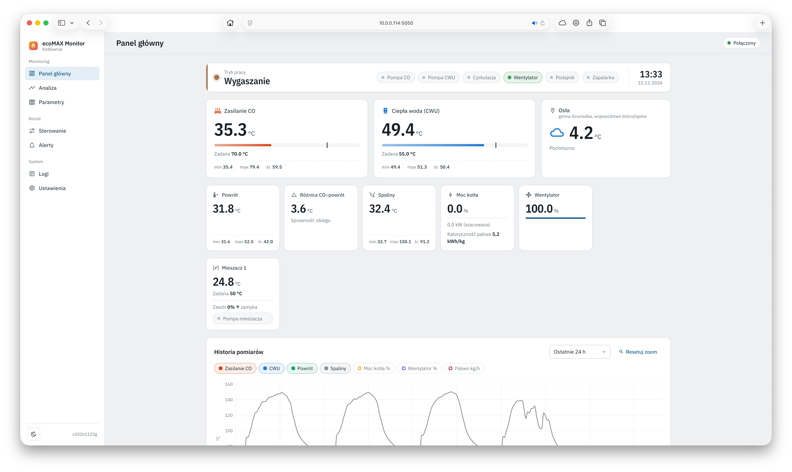

## Analiza pracy

Podsumowanie wybranego okresu, udział trybów pracy, zużycie paliwa i koszty.

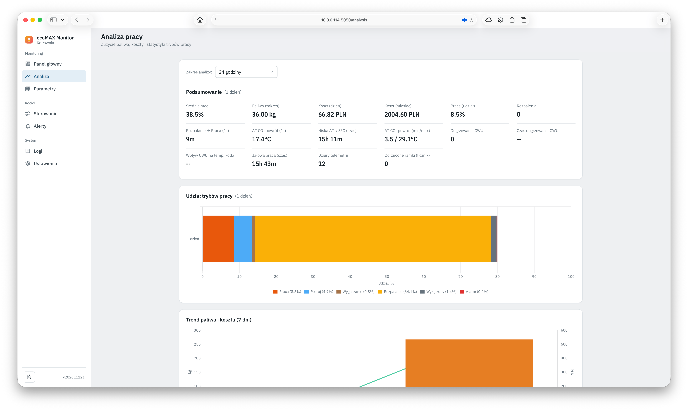

## Parametry

Wszystkie wartości odczytywane ze sterownika.

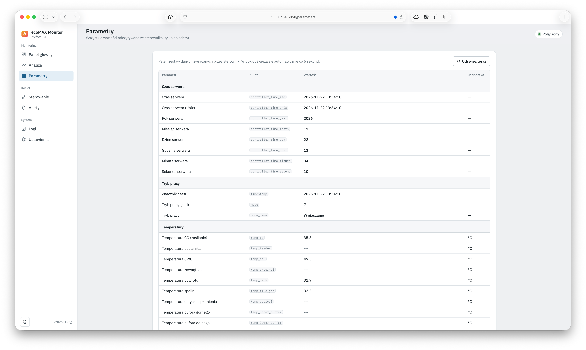

## Sterowanie

Informacje o urządzeniu, włączanie/wyłączanie kotła i nastawy.

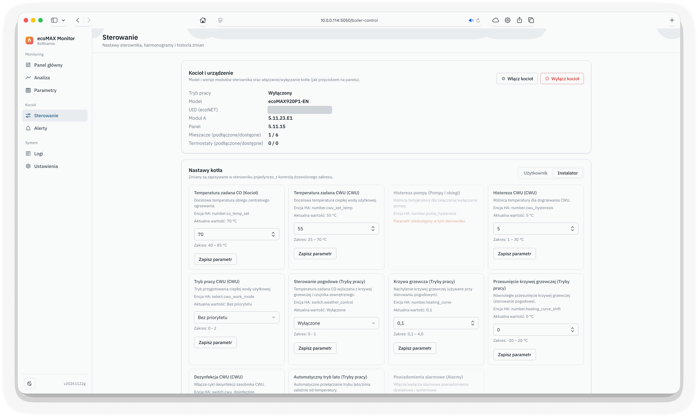

Parametry mieszacza.

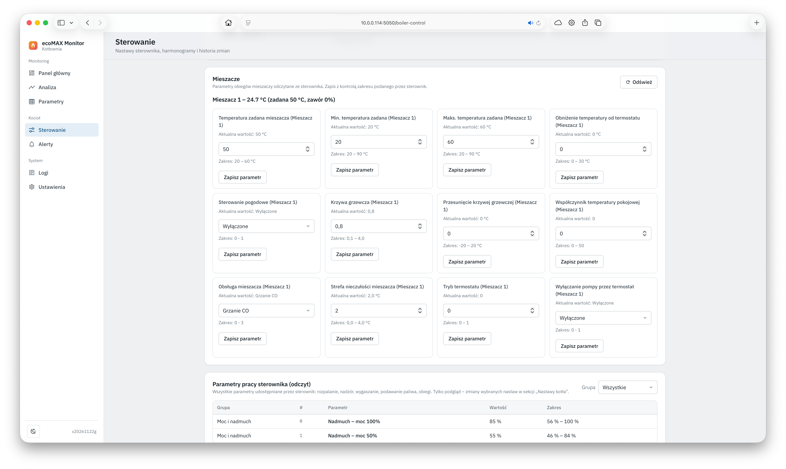

Parametry pracy sterownika z polskimi opisami (tylko odczyt).

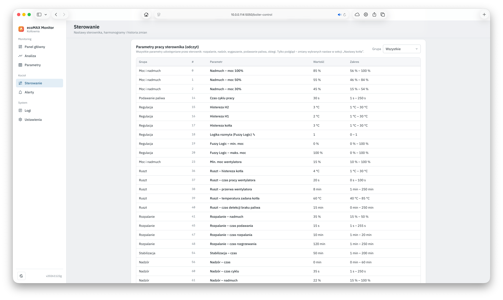

Historia zmian ustawień i harmonogramy tygodniowe.

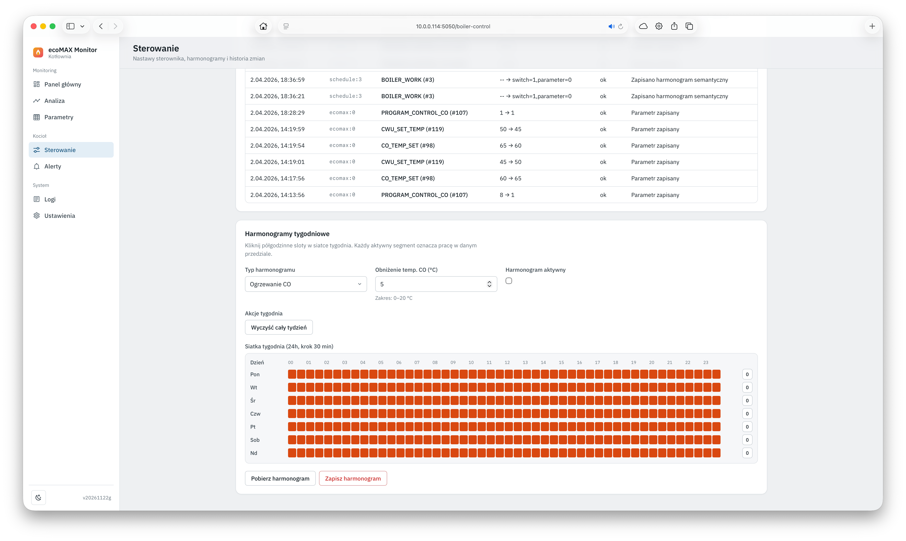

## Alerty

Alerty aplikacji i historia alarmów zapisanych w sterowniku.

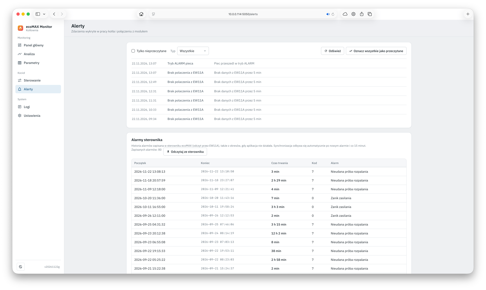

## Logi

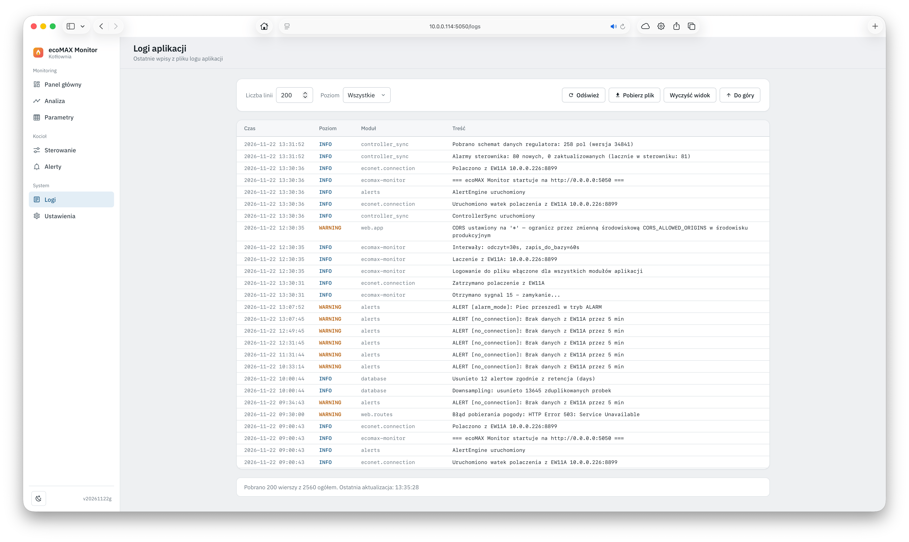

## Ustawienia

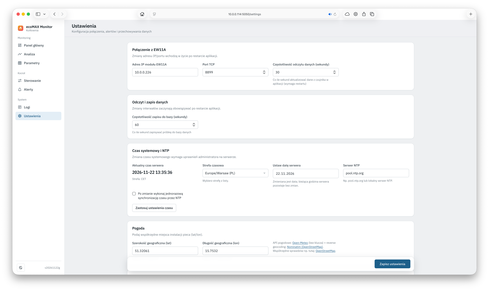

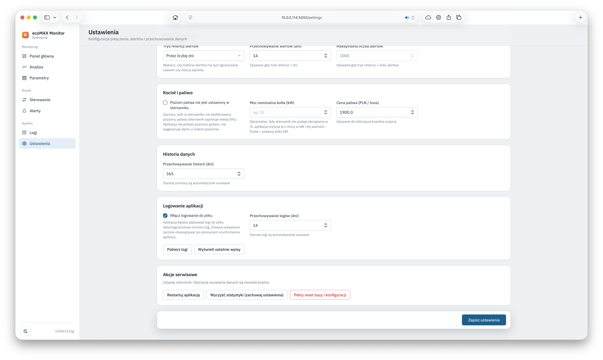
