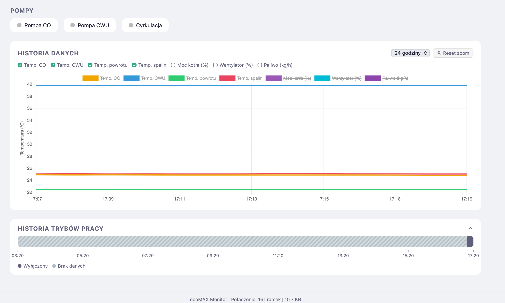
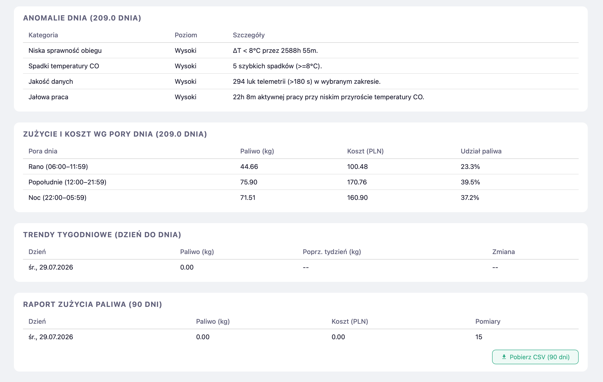
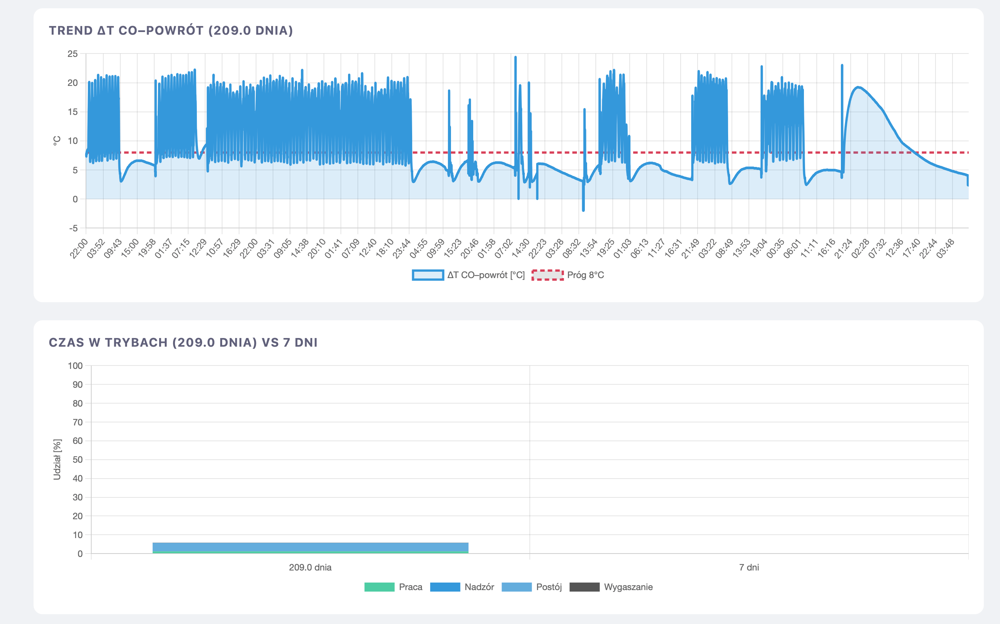
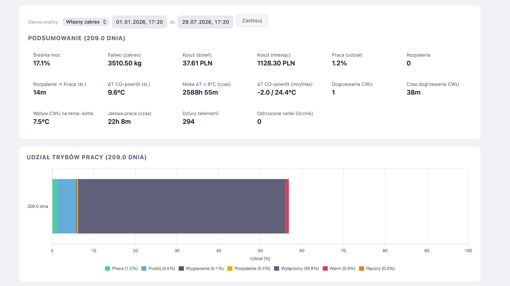
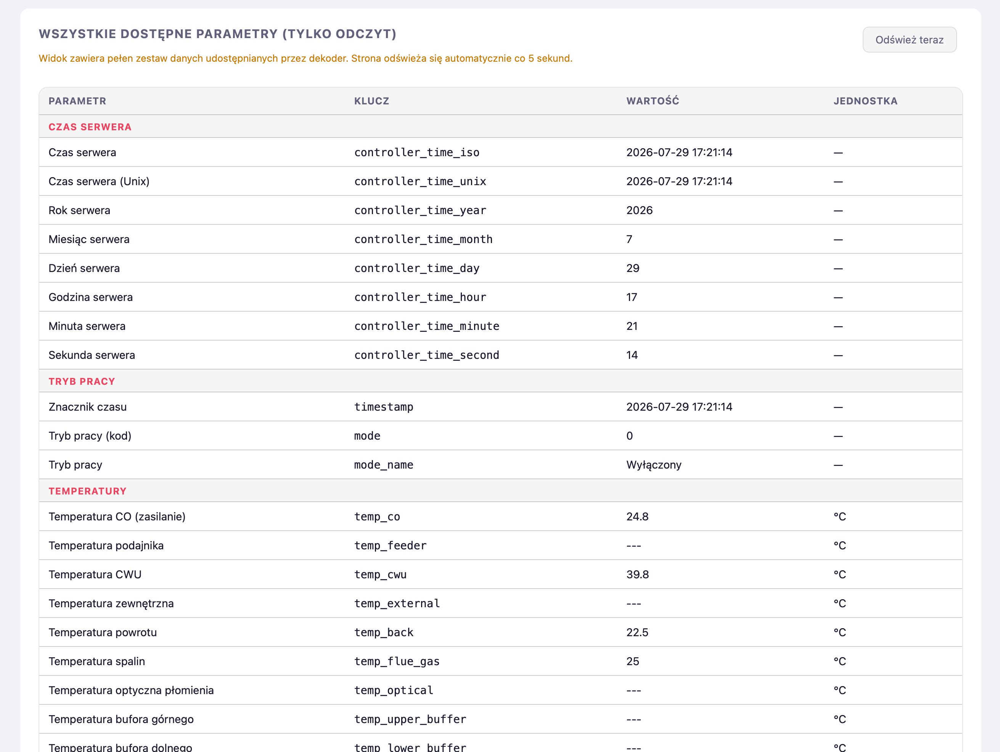
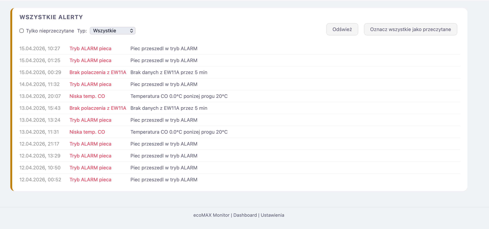
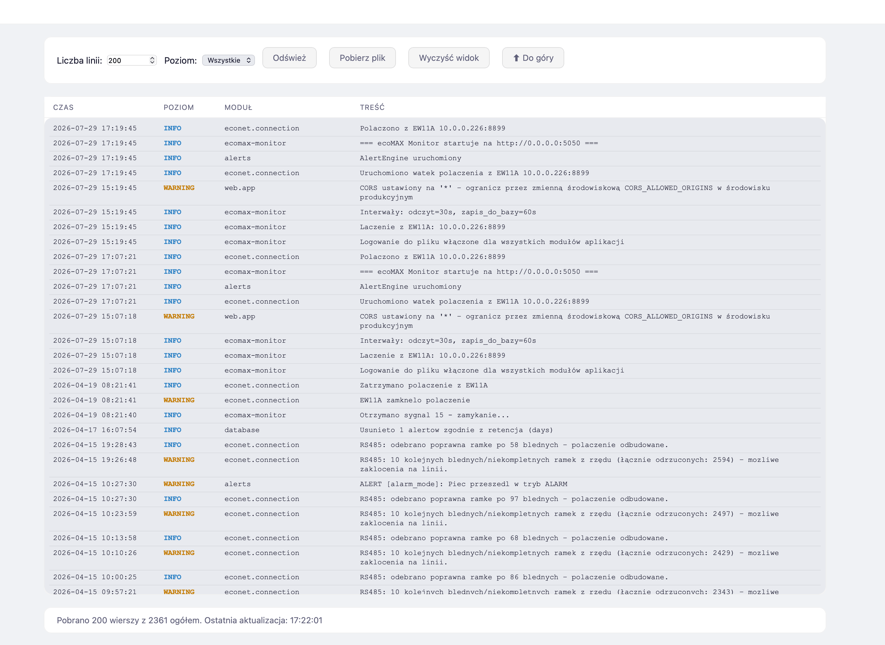
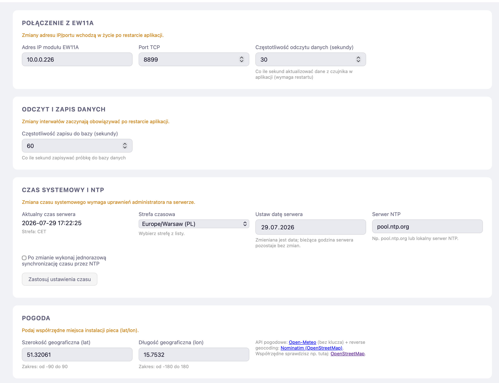
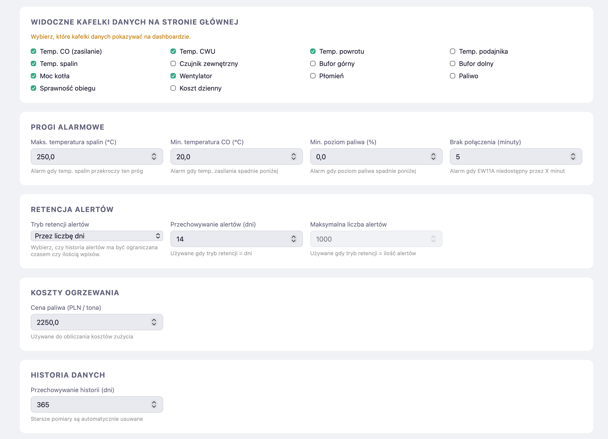

# Galeria zrzutów ekranu

Zrzuty ekranu poszczególnych stron aplikacji [ecoMAX Monitor](README.md). Dashboard znajduje się w głównym [README.md](README.md).

## Dashboard

## Dane bieżące

## Analiza — wykresy

## Parametry

## Alerty

## Logi

## Ustawienia

